<div align="center">


# SUPERPORT Portfolio Cockpit for Jira

**Rank your projects. See where capacity runs out. Plan the week. Prove every number.**

One cockpit for portfolio, capacity and delivery, built on Atlassian Forge and computed live from your Jira.
Leadership sees what fits this quarter, team leads plan the week, and everyone books their time in one place.
Every figure explains itself, and every change can be undone.


<a href="docs/marketplace/LISTING.md"><b>Marketplace listing</b></a> ·
<a href="docs/marketplace/DATA_SECURITY_PRIVACY.md"><b>Security &amp; privacy</b></a> ·
<a href="docs/READINESS.md"><b>Review readiness</b></a> ·
<a href="docs/TESTER-GUIDE.md"><b>Tester guide</b></a> ·
<a href="CHANGELOG.md"><b>Changelog</b></a>

<br/><br/>

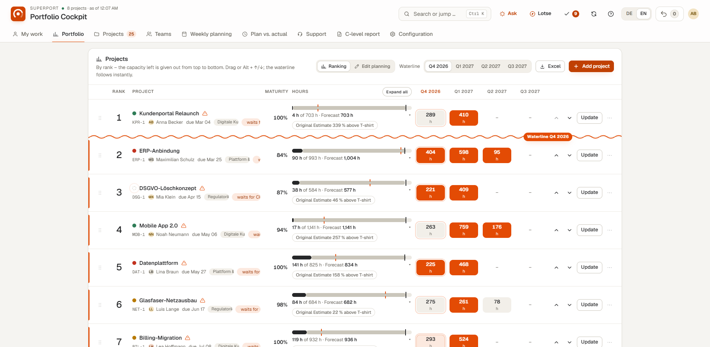

<sub>The portfolio in rank order. The orange <b>waterline</b> shows how far this quarter's capacity reaches – support first, then projects top to bottom.</sub>

</div>

---

## Why

Most portfolio tools ask you to maintain a second truth next to Jira. Then the spreadsheet is out of date by Tuesday,
nobody trusts the traffic lights, and the question *"what can we actually deliver this quarter?"* is answered by gut
feeling.

The Portfolio Cockpit takes a different route:

- **Jira is the only source.** Projects, work items, estimates, worklogs, teams and dates are read live from your site,
  as the signed-in user. Nothing is copied into a second system.
- **One ranked list decides.** Capacity is handed out from the top of the ranking down – support and daily business
  first. Where it runs out, the waterline cuts the list. Re-rank a project and the waterline moves instantly.
- **Numbers you can defend.** Hover any figure for its arithmetic; *Nachweis / Proof* lists the work items behind it.
  The same engine feeds every view, the C-level report and the exports, so the numbers always agree.
- **Undo for everything.** Rank changes, plans written to Jira, capacities, configuration – each step has its own undo.

## Highlights

| | |
|---|---|
| 📊 **Portfolio & waterline** | All projects in rank order with progress, forecast, maturity and health. Drag to re-rank (or Alt + ↑/↓); the waterline per quarter shows which projects are fully staffable. "Waits for …" chips show who is blocked by whom. |
| 🗂️ **Project pages** | Everything for one project: what needs action, missing values (fill them in place), capacity per team and week, dependencies, structure and an AI-free briefing. |
| 👥 **Teams** | What each team works on, its load, blocked and overdue work, missing values – and the capacity editor: weekly hours, daily business, team shares for people in several teams, locations and public holidays. |
| 🗓️ **Weekly planning** | A person × week board for the weekly meeting. Drag work to another week or person; changes stay pending until **Apply to Jira**. Distribute hours evenly or by free capacity, see why each hour landed where it did, and let *Optimise* suggest how to finish sooner or smooth overload. |
| ⚖️ **Plan vs. actual** | Every Monday the plan is recorded; the cockpit compares it with what was booked, shows where the time went and why things shifted, plus a booking check per person. |
| 🧑‍💻 **My work** | Each person's week: type hours into a cell and they are booked in Jira. *Complete my week* proposes missing hours from your own Jira activity – nothing is booked until you take it. |
| 🛟 **Support & SLAs** | For service spaces: dispatch tickets with a suggested team and person, check whether the support reserve is enough, see where support time goes, SLA status in business hours, and playbooks for recurring topics. |
| 📄 **C-level report** | The situation on one page – key figures, who waits for whom, capacity by rank per quarter – as PDF, Excel or a Confluence page. The **report composer** builds custom reports section by section. |
| 🧭 **Lotse** | The cockpit's own navigator, with no AI needed: ask in plain German or English ("Which projects are late?", "Plan Netz for next week"), get answers computed from your data with their sources, and run multi-step jobs with a preview and undo. |
| ✦ **Ask – "I want …"** | Type a wish ("I want to avoid overtime", "estimate like last time: interface to the warehouse") and get a card with a chart, one plain sentence and the calculation behind it. Learns from similar finished work. |
| 🤖 **Optional AI** | Off by default. A Jira admin can switch on Forge LLM features (free answers, project briefings, report summaries, health drafts). AI runs inside Atlassian's cloud, with a monthly budget per site; every AI answer is cross-checked against the cockpit's own numbers. |
| 🌍 **DE / EN, light / dark** | Every text in German and English, following Jira's language and theme. WCAG 2.2 AA checked with axe-core. |

<details>
<summary><b>📸 See every view</b></summary>

<br/>

| | |
|---|---|
| 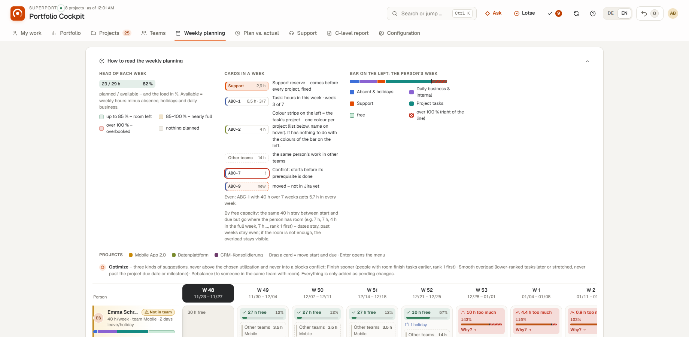 <br/> **Weekly planning** – person × week, with absences, support and free time per week | 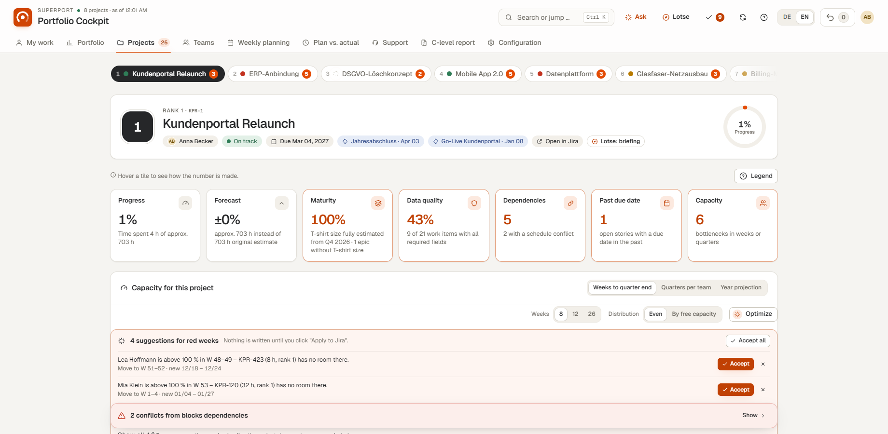 <br/> **Project page** – what needs action, capacity per team, dependencies |
| 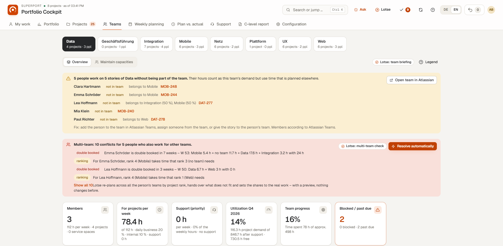 <br/> **Teams** – load, conflicts across teams, missing values | 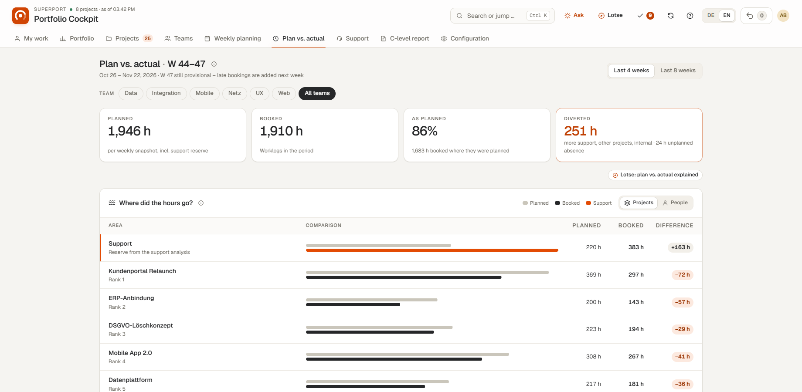 <br/> **Plan vs. actual** – planned against booked, and why it shifted |
| 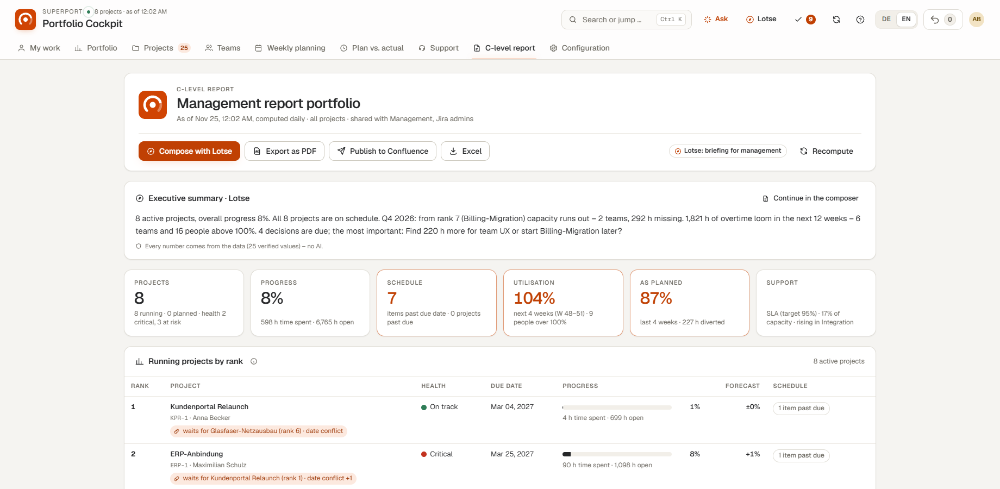 <br/> **C-level report** – one page for management, PDF or Confluence | 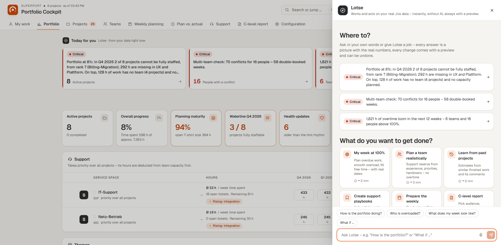 <br/> **Lotse** – answers and jobs, computed from your data |
| 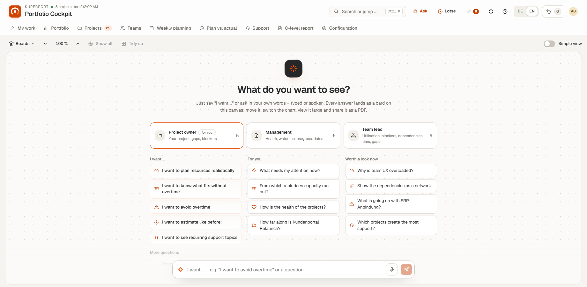 <br/> **Ask – "I want …"** – wishes become cards with the math behind them | 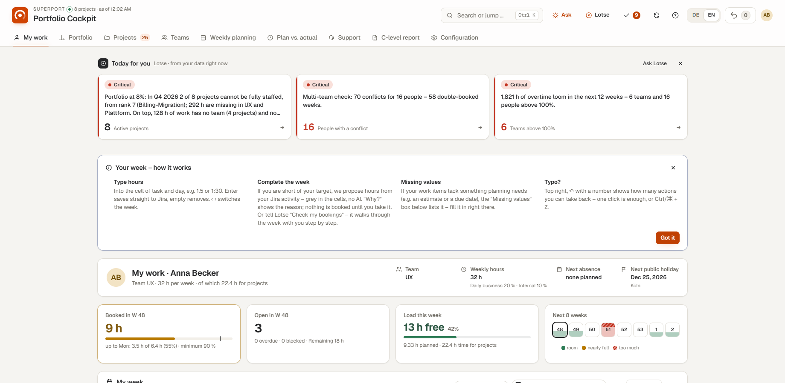 <br/> **My work** – book the week, fill what is missing |
| 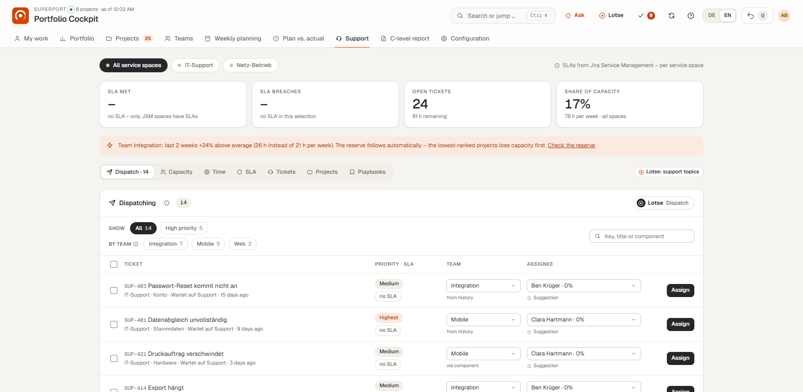 <br/> **Support** – dispatch, reserve check, SLAs | 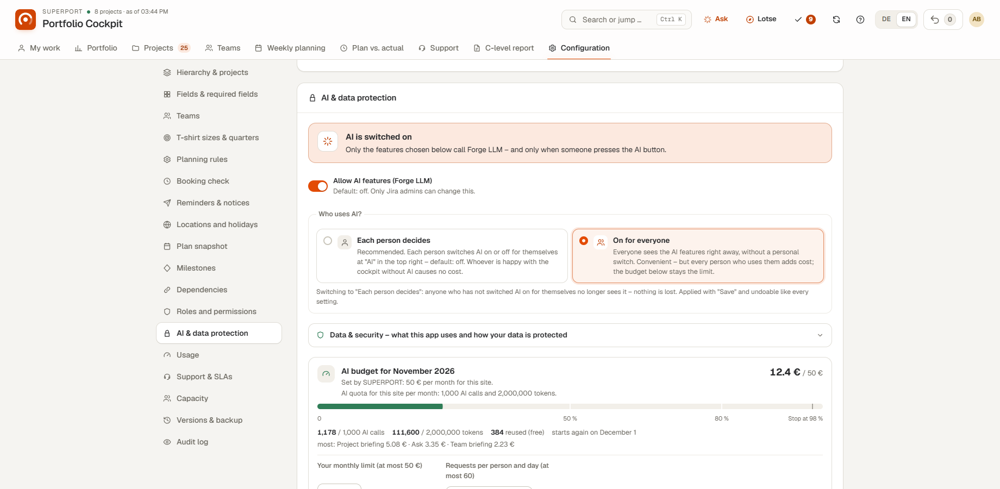 <br/> **AI & data protection** – off by default, budget and usage |

<sub>All screenshots use the app's built-in demo portfolio (fictional people and projects).</sub>

</details>

## How the waterline works

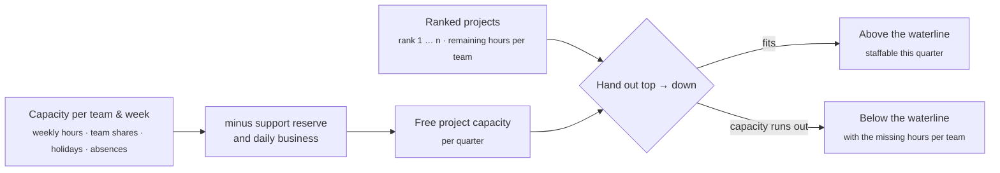

Re-rank, change a capacity or move a due date and the waterline is recomputed in the browser instantly. Every cell
explains its arithmetic on hover.

## How a change flows

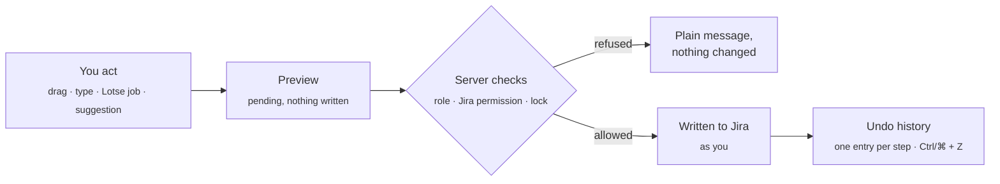

- **Nothing behind your back.** Board moves, Optimise suggestions and proposals for your week stay pending until you
  apply them. Reminders and notices are sent only after a Jira admin switches them on.
- **Each automatic step can be undone on its own.** A plan applied to Jira creates one undo entry per work item.
- **Writes run as the user.** Jira's own permissions decide; the app's fields are written as the app only after a
  visibility and EDIT check as the user.

## Roles and security

Roles are worked out on the server for every call; the browser never decides. A Jira admin maps Jira groups to the
roles and can adjust the rights matrix (Configuration › Roles and permissions). These are the defaults:

| Role | Who | Sees | Can change |
|---|---|---|---|
| **Employee** | Every Jira user | My work | Own worklogs and the missing values on own work items |
| **Project admin** | Mapped Jira groups | Portfolio, projects, teams, planning, plan vs. actual, support | Capacities, weekly plans, dispatch, health; booking details of their teams |
| **Management** | Mapped Jira groups | All of the above plus the C-level report | Additionally the ranking; booking details of everyone |
| **Jira admin** | "Administer Jira" | Everything | Configuration, AI switch, audit log – individual values of people only when granted deliberately |

Project owners may always update the health of their own projects.

- **Identity from the platform.** Account and site always come from the Forge context, never from the payload.
- **Reads as the user.** Browse permissions, issue security and worklog visibility apply; projects you cannot see are
  not even counted.
- **Privacy switches.** With person-level detail off, assignees and worklog authors are pseudonymised on the server.
  Absence reasons are shown only to people who may edit capacities.
- **AI off by default.** While off, every AI entry point is hidden and the server refuses before any data is read.
  When on, the AI gets a fact sheet built only from what the asking person may see; text inside Jira is treated as
  data, never as instructions; links, e-mail addresses and anything that looks like a secret are removed first.
- **AI cost under control.** Forge LLM is billed to SUPERPORT. Each site has a monthly AI budget (20 € by default
  from December 2026, set per app and site by SUPERPORT), a cap of 1,000 calls and 2,000,000 tokens, and at most 60
  requests per person and day. A site admin can only lower these. At the limit the cockpit keeps working with its own
  rules.
- **No Rovo.** By company policy the app declares no Rovo module; `tests/norovo.test.js` and a runtime allow-list
  (`src/lib/norovo.js`) keep it that way.
- **Runs on Atlassian.** No remote back end, no egress, no secrets. Data stays in Jira and in Forge storage.

Details: [docs/THREAT-MODEL.md](docs/THREAT-MODEL.md) · [SECURITY.md](SECURITY.md) · [PRIVACY.md](PRIVACY.md)

## Architecture

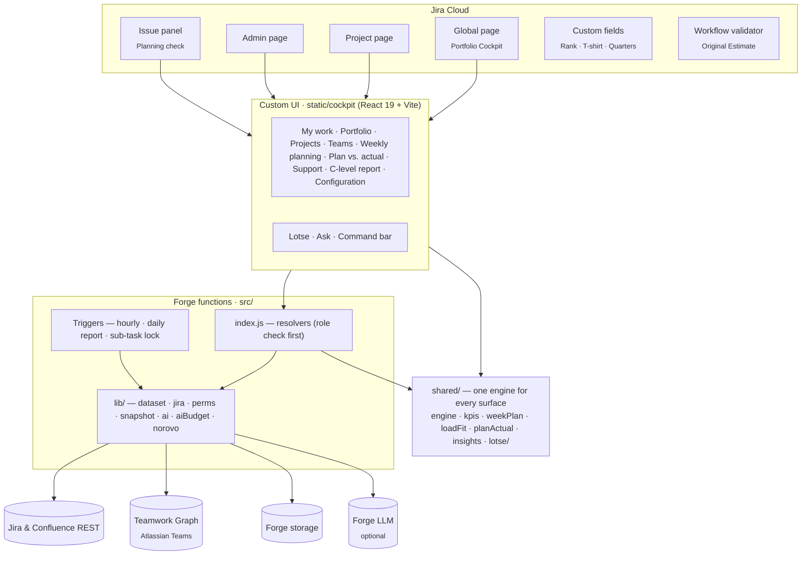

The engine in `shared/` is plain JavaScript with no dependencies. The server, the browser (in a web worker), the PDF
and Excel exports and Lotse all run the same code, so every surface gives the same answer.

```
manifest.yml       Forge modules, triggers, the three app fields, the LLM module and the 9 scopes
src/
  index.js         Resolvers: bootstrap, dataset, writes, configuration, report, Lotse, AI
  lib/             dataset.js (hierarchy walk, Jira Plans fast path) · jira.js (REST, retry, 429 → BUSY)
                   perms.js (roles) · snapshot.js · ai.js + aiBudget.js (Forge LLM, budget) · norovo.js
shared/            The engine: KPIs, waterline, week plan, load fit, plan vs. actual, SLAs, insights,
                   Lotse (understand → plan → act → narrate, every number sourced)
static/cockpit/    Custom UI (React 19, Vite, framer-motion, jsPDF, ExcelJS); mock back end for local work
tests/             814 Node tests: engine, golden dataset, property tests, security, Lotse, AI budget, perf
tools/             Demo-data generator (seeded), big-dataset builder
docs/              Readiness, threat model, decisions, tester guide, Lotse design, Marketplace kit
scripts/           capture-marketplace.mjs – screenshots, hero and banner from the demo data
```

## Getting started

### Prerequisites

- Node.js 22
- The [Forge CLI](https://developer.atlassian.com/platform/forge/getting-started/): `npm install -g @forge/cli`
- A Jira Cloud site where you are an admin (Jira Premium for the "projects are work items" mode with Plans; every
  edition for "projects are spaces")

### Install and run locally

```bash
npm install
npm --prefix static/cockpit install

npm test                                   # the unit, golden, property, security and Lotse suites
npm --prefix static/cockpit run dev        # the UI with a demo portfolio on http://localhost:5179
```

The local UI runs on a built-in demo portfolio. A few URL parameters switch scenarios:

| Parameter | Scenario |
|---|---|
| `?role=employee` | An employee: only *My work* |
| `?theme=dark` | Dark theme |
| `?ai=on` / `?ai=on&access=all` | AI switched on (per person / for everyone) |
| `?budget=sitecaps` · `capzero` · `vendor` | AI budget states: site caps, cap 0, vendor stop |
| `?fresh=1` · `?empty=1` | First run before setup, an empty site |

### Deploy to your site

```bash
forge login
npm run build:ui
forge deploy -e development
forge install --site <your-site>.atlassian.net --product jira -e development
```

Then open **Apps › SUPERPORT Portfolio Cockpit** in Jira. A Jira admin runs the six setup steps in
**Configuration** (hierarchy, fields, teams, groups, locations, optional support spaces).

> **Production:** SUPERPORT releases through its ops CLI, which runs `npm test` first and deploys a tagged clean build.
> A scope change needs `forge install --upgrade` on every site.

## Quality

| Check | Result |
|---|---|
| Unit, golden and property tests | 814 passing (`npm test`) |
| Golden dataset | 22/22 metrics match independent spreadsheet formulas (`tests/golden/`) |
| Scale | 15 projects · 1,215 work items: data in 3.6 s, every view ready in ≤ 4 s ([docs/DEMO-DATA.md](docs/DEMO-DATA.md)) |
| Live end-to-end | 35 self-test suites on a Jira site with 1,400 demo work items, then verified on production |
| Accessibility | axe-core WCAG 2.2 AA: 0 violations in every view, light and dark |
| Security | Marketplace security requirements reviewed ([docs/READINESS.md](docs/READINESS.md)); `forge lint` clean; no high or critical dependency findings |
| Runs on Atlassian | Eligible (`forge eligibility -e production`) |

## Contributing

1. Keep `shared/` free of dependencies and side effects. It runs on the server, in the browser and in the exports.
2. Every user-facing text exists in **German and English**.
3. Every write path needs a role check on the server, a test, and an undo.
4. A number shown to a user must be explainable: hover text, *Proof*, and for Lotse a source for every figure.
5. Run `npm test` and `npm run build:ui` before you deploy.

## License

Proprietary. © 2026 SUPERPORT P.C. All rights reserved. See [LICENSE](LICENSE).
